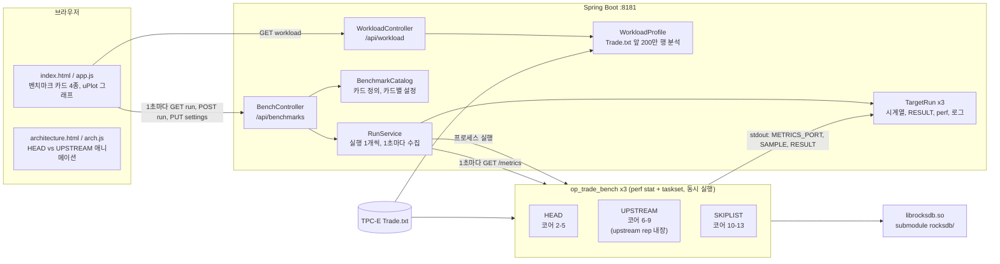
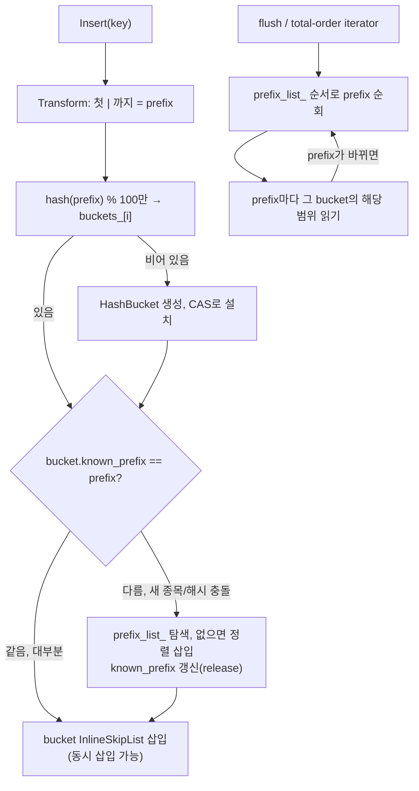

# HASH(Rocksdb)

## 개요

HashSkipList는 RocksDB가 기본 제공하는 Memtable 구현 중 하나였으나, 멀티 스레드 불가 / 느린 Range Query 성능(Memtable 전체 복사) / SkipList의 비효율적인 메모리 배치 등으로 외면되어 존재만 하는 Memtable이었다.<br>
HashSkipList의 각 Bucket은 SkipList로 관리되고 있었고, 디폴트 Memtable인 SkipList(InlineSkipList)의 경우 멀티 스레드를 지원하고 있었으므로 Bucket 교체만으로 동시성 처리가 가능해 보였다.<br>
오픈소스SW빅데이터 과목에서 Bucket을 SkipList에서 InlineSkipList로 교체함에 따라 멀티 스레드 지원이 충분히 가능함을 보였고, 이번 졸업 작품은 과목 때 지적받은 Hash 자료구조의 Range Query 난제를 해결했다.<br>
이에 따라 HashSkipList 역시 운영 상황에서 충분히 사용 가능할 정도의 성능을 확보했으며 특정 상황에서는 기본 SkipList보다 좋은 성능을 보인다.<br>
이번 졸업작품은 rocksdb를 기반 기술로 쓰는 Alluxio 또는 MySQL 등의 개발자들에게 충분히 고려할 만한 Memtable 선택지를 제공하는데의 의의를 둔다. 

| 비교 대상 | 설명 |
|---|---|
| **HEAD** | 이 프로젝트의 HashSkipListRep. bucket을 InlineSkipList로 바꾸고, 정렬된 prefix 목록(`prefix_list_`)과 `PrefixOrderedIterator`로 복사 없이 key 순서 순회 |
| **UPSTREAM** | facebook/rocksdb `e591f5f1a`의 원래 HashSkipListRep. 동시 쓰기 불가, total-order 순회 때 memtable 전체 복사 |
| **SKIPLIST** | RocksDB 기본 memtable(InlineSkipList 하나). 동시 쓰기 지원 |

RocksDB 변경분은 submodule [`rocksdb/`](https://github.com/psmsq4/rocksdb_hash/tree/hash_skiplist_improvements)의 커밋 5개다.

| 커밋 | 내용 |
|---|---|
| `91549bab9` | bucket을 SkipList에서 InlineSkipList로 교체 |
| `4f8df92bc` | 동시 쓰기 지원(`InsertConcurrently`, bucket CAS 설치) |
| `5384b9422` | `prefix_list_` + `PrefixOrderedIterator`로 복사 없는 total-order 순회 |
| `42ac47a08` | `prefix_list_` 최소 높이 12 |
| `1888cce21` | bucket별 `known_prefix` 캐시로 삽입 때 `prefix_list_` 조회 생략 |

## 테스트 환경

| 항목 | 사양 |
|---|---|
| CPU | Intel Core i9-12900K, 16코어 24스레드(P코어 8개 = 논리 0-15, E코어 8개 = 16-23), 최대 5.2GHz |
| 캐시 | L2 14MB, L3 30MB |
| 메모리 | 124GB |
| 저장장치 | Samsung PM9A1 NVMe 2TB × 2 (MZVL22T0HBLB) |
| OS | Rocky Linux 10.2, Linux 6.12 |
| 컴파일러 | GCC 14.3.1, CMake 3.31.8 |
| Java | OpenJDK 21.0.8, Gradle 8.10, Spring Boot 3.5.9 |
| 데이터 | TPC-E EGen v1.14.0 `Trade.txt` (고객 5,000, scale factor 500, 초기 거래 300일, 28,664,881행, 3.2GB) |

- 세 memtable은 같은 KV를 **동시에** 실행하고, 서로 다른 P코어 묶음에 고정한다(HEAD `2-5`, UPSTREAM `6-9`, SKIPLIST `10-13`).
- key는 `trade_종목|t_id`(시간순) 또는 `trade_종목|계좌|t_id`, prefix는 첫 `|`까지(종목, 약 3,400개)다. value는 거래 행의 나머지 열이다.
- bucket 수 100만, HEAD/UPSTREAM bucket 높이 12, WAL 끔.

## 성능

시연 웹의 벤치마크 카드 4종을 기본 설정으로 1회씩 실행한 값이다(2026-11-13). 같은 카드라도 실행마다 ±10% 정도 달라진다. 괄호 안은 UPSTREAM 대비.

### 1. Flush 시간
1,000만 건, memtable 64MB, `trade_종목|t_id`, 쓰기 큐 + 소비자 1개, 끝에 `DB::Flush`

| 지표 | HEAD | UPSTREAM | SKIPLIST |
|---|---|---|---|
| **평균 flush 시간** | **148.4 ms (-35%)** | 227.4 ms | 173.8 ms (-24%) |
| flush 횟수 | 28 | 28 | 24 |
| 쓰기 처리량 | 69.8만 ops/s | 70.8만 ops/s | 42.8만 ops/s |
| Put p99 | 2.67 µs | 2.61 µs | 4.38 µs |
| 정확도 검증 | 1,000만 건, 내용 해시 일치 | 일치 | 일치 |

### 2. 멀티 스레드 쓰기
800만 건, memtable 512MB, `trade_종목|계좌|t_id`, preload, 소비자 4개, 동시 memtable 쓰기 켬

| 지표 | HEAD | UPSTREAM | SKIPLIST |
|---|---|---|---|
| **쓰기 처리량** | **55.7만 ops/s (×1.64)** | 34.0만 ops/s | 52.9만 ops/s (×1.56) |
| Put p50 | 5.66 µs | 10.82 µs | 6.30 µs |
| Put p99 | 10.18 µs (-57%) | 23.68 µs | 11.07 µs |
| 적재 시간 | 16.3 s | 25.4 s | 17.0 s |
| 평균 flush 시간 | 1,290 ms | 2,207 ms | 1,291 ms |
| 정확도 검증 | 800만 건, 내용 해시 일치 | 일치 | 일치 |

UPSTREAM은 동시 삽입을 지원하지 않아, 쓰기 그룹의 리더 한 스레드가 모든 KV를 넣는다.

### 3. Range query (범위 조회)
200만 건, memtable 512MB(flush 없음), `trade_종목|t_id`, scan마다 iterator를 새로 열고 최대 100개 읽기, 각 8초

| 지표 | HEAD | UPSTREAM | SKIPLIST |
|---|---|---|---|
| prefix scan p50 | **19.07 µs (-37%)** | 30.08 µs | 19.84 µs |
| prefix scan 초당 | 54,436 | 34,790 | 51,577 |
| **total-order scan p50** | **20.35 µs** | **320,864 µs (320.9 ms)** | 19.33 µs |
| total-order scan 초당 | 48,256 | 3.1 | 50,959 |

UPSTREAM은 total-order iterator를 열 때마다 memtable 200만 건을 새 SkipList로 복사한다. HEAD는 복사하지 않아 약 15,800배 빠르고, SKIPLIST와 같은 수준이다.

### 4. Point query (점 조회)
500만 건, memtable 2GB(flush 없음), `trade_종목|계좌|t_id`, `DB::Get` 무작위 각 4초

| 지표 | HEAD | UPSTREAM | SKIPLIST |
|---|---|---|---|
| 있는 key p50 | **2.99 µs (-11%)** | 3.38 µs | 3.22 µs |
| 있는 종목의 없는 key p50 | **2.90 µs (-12%)** | 3.31 µs | 3.18 µs |
| 없는 종목 p50 | **0.38 µs** | 0.38 µs | 2.45 µs |
| 있는 key 초당 | 31.3만 | 28.2만 | 29.1만 |

없는 종목은 hash로 빈 bucket을 바로 확인하므로 hash 계열이 SKIPLIST보다 약 6.5배 빠르다.

## 아키텍처

### 시연 웹



- 카드의 "측정 시작"을 누르면 `RunService`가 세 memtable로 `op_trade_bench`를 동시에 띄운다. 각 프로세스는 빈 포트에 Prometheus 형식 `/metrics`를 열고, 백엔드가 1초마다 읽어 시계열로 쌓는다.
- 끝나면 마지막 `RESULT key=value ...` 줄(지연 분위수, scan/Get 결과, 검증 해시)과 `perf stat` 카운터를 붙여 둔다. 페이지는 1초마다 `GET /api/benchmarks/{id}/run`으로 받아 그린다.
- UPSTREAM 구현은 `op_trade_bench/upstream_hash_skiplist_rep.cc`로 측정기에 내장돼 있다. 그래서 한 바이너리, 한 `librocksdb.so`로 세 memtable을 비교한다.

### HashSkipListRep (HEAD)



시연 웹의 "아키텍처" 메뉴에서 삽입, flush, prefix scan, total-order scan, 멀티 스레드 쓰기, 해시 충돌을 HEAD와 UPSTREAM이 나란히 움직이는 애니메이션으로 볼 수 있다.

## 의존성

### C/C++ (RocksDB, 측정기)
| 항목 | 버전 | 비고 |
|---|---|---|
| Linux x86_64 | | 측정기가 POSIX/Linux 정의와 `-march=native`로 빌드됨 |
| GCC (g++) | C++20 지원, 14.3.1에서 확인 | `-std=gnu++20 -fno-rtti` |
| CMake, make | 3.31.8에서 확인 | RocksDB 빌드 |
| 압축/부가 라이브러리 | 없음 | snappy, zstd, zlib, gflags, jemalloc 모두 끄고 빌드 |
| `taskset` (util-linux) | | 코어 고정. 쓰지 않으려면 `demo.cpu-sets` 값을 비운다 |
| `perf` | 선택 | 없거나 권한이 없으면 카운터만 빠짐 |

### Java (시연 웹)
| 항목 | 버전 |
|---|---|
| JDK | 21 |
| Gradle | 8.10 (wrapper 포함) |
| Spring Boot | 3.5.9 (`spring-boot-starter-web`) |
| uPlot | 1.6.30 (`static/vendor`에 포함, 외부 CDN 없음) |

### 데이터
- TPC-E [EGen](https://www.tpc.org/tpc_documents_current_versions/current_specifications5.asp) v1.14.0이 만든 `Trade.txt`. 기본 위치는 `~/tpc-e/flat_out/Trade.txt`(`TPCE_DIR`, 또는 `application.yml`의 `demo.trade-file`로 변경).
- 생성 설정: `EGenLoader -c 5000 -t 5000 -f 500 -w 300 -i flat_in -o flat_out`

## 빌드

### 저장소 받기
RocksDB fork가 submodule이므로 `--recursive`로 받는다.
```bash
git clone --recursive https://github.com/psmsq4/rocksdb_hash_demo.git
cd rocksdb_hash_demo
# 이미 받았다면: git submodule update --init
```

```
rocksdb_hash_demo/
├─ rocksdb/          submodule: psmsq4/rocksdb_hash, 브랜치 hash_skiplist_improvements
├─ op_trade_bench/   측정기 (C++)
├─ src/              시연 웹 (Spring Boot + 정적 페이지)
├─ experiments/      실험 스크립트와 결과
└─ HANDOFF.md        작업 기록, 측정 방법론
```

### RocksDB (Release 공유 라이브러리)
```bash
mkdir -p rocksdb/build-rel && cd rocksdb/build-rel
cmake .. -DCMAKE_BUILD_TYPE=Release -DROCKSDB_BUILD_SHARED=ON \
  -DWITH_TESTS=OFF -DWITH_BENCHMARK_TOOLS=OFF -DWITH_TOOLS=OFF -DWITH_CORE_TOOLS=OFF \
  -DWITH_GFLAGS=OFF -DFAIL_ON_WARNINGS=OFF
make -j8 rocksdb-shared      # 작업 1개당 RAM 약 1GB
cd ../..
```

RocksDB 단위 테스트(선택):
```bash
mkdir -p rocksdb/build && cd rocksdb/build
cmake .. -DCMAKE_BUILD_TYPE=Debug -DWITH_TESTS=ON
make -j8 db_memtable_test prefix_test inlineskiplist_test
./db_memtable_test --gtest_filter='*HashSkipList*'
```

### 측정기 (op_trade_bench)
```bash
op_trade_bench/build.sh      # rocksdb/build-rel/librocksdb.so에 링크 → op_trade_bench/out/op_trade_bench
```
다른 RocksDB checkout을 쓰려면 `ROCKSDB_ROOT=/path/to/rocksdb op_trade_bench/build.sh`.

### 시연 웹
```bash
./gradlew bootJar            # build/libs/rocksdb-demo-0.1.0.jar
./gradlew test               # 단위 테스트
```

## API 명세

기본 주소 `http://127.0.0.1:8181`. 모든 응답은 JSON이고, 측정은 한 번에 하나만 실행된다.

| 메서드 | 경로 | 설명 | 응답 |
|---|---|---|---|
| GET | `/api/benchmarks` | 카드 목록과 현재 설정 | 200 `[{id, kind, title, summary, targets, settings}]` |
| GET | `/api/benchmarks/{id}/settings` | 현재 설정, 기본값, 허용 범위, 예상 시간 | 200 `{settings, defaults, limits, estimateSeconds}` / 404 |
| PUT | `/api/benchmarks/{id}/settings` | 카드 설정 변경(서버 메모리에 저장, 재시작하면 기본값) | 200 위와 같음 / 400 `{error}` / 404 `{error}` |
| POST | `/api/benchmarks/{id}/run` | 측정 시작(세 memtable 동시 실행) | 202 실행 snapshot / 404 / 409 `{error}`(다른 측정 진행 중, 측정기 없음) |
| GET | `/api/benchmarks/{id}/run` | 가장 최근 실행(진행 중 또는 완료) | 200 실행 snapshot / 204(아직 없음) |
| POST | `/api/benchmarks/{id}/stop` | 진행 중인 측정 중지 | 202 |
| GET | `/api/workload` | `Trade.txt` 앞 200만 행의 형태 | 200 `{available, file, fileBytes, sampledRows, estimatedRows, symbols, accounts, perSymbolMin/Median/Max, avgKeyBytes, avgValueBytes, firstTime, lastTime}` |

`{id}`는 `flush`, `write`, `scan`, `get`이다.

### 설정 (`RunSettings`)
```json
{
  "kv": 10000000, "memtableMb": 64, "keyFormat": "symb_tid",
  "preload": false, "wal": false, "consumers": 1, "hashHeight": 12,
  "concurrent": true, "scanSeconds": 0, "scanLength": 100, "getSeconds": 0, "verify": true
}
```
| 필드 | 범위 | 뜻 |
|---|---|---|
| `kv` | 10만 ~ 3,000만, 10만 단위 | 넣을 KV 개수 |
| `memtableMb` | 64 또는 128 단위, 최대 2048 | `write_buffer_size` |
| `keyFormat` | `symb_tid`, `symb_acct_tid` | `trade_종목\|t_id`, `trade_종목\|계좌\|t_id` |
| `preload` | bool | KV를 먼저 메모리에 만들고 쓰기만 측정 |
| `wal` | bool | write-ahead log |
| `consumers` | 1 ~ 8 | 쓰기 스레드 수 |
| `hashHeight` | 4, 12 | HEAD/UPSTREAM bucket skiplist 최대 높이 |
| `concurrent` | bool | `allow_concurrent_memtable_write`(HEAD, SKIPLIST) |
| `scanSeconds`, `scanLength` | 0 ~ 30초, 10 ~ 1000 | prefix/total-order scan 시간과 길이 |
| `getSeconds` | 0 ~ 30초 | hit / miss / 없는 종목 Get 시간 |
| `verify` | bool | flush 전후 전체를 key 순서로 읽어 개수, 정렬, 내용 해시 비교 |

### 실행 snapshot
```text
{ id, benchmark, startedAt, active, elapsed, settings, perfNote, kvSamples[],
  targets: {
    HEAD | UPSTREAM | SKIPLIST: {
      memtable, cpuSet, state (STARTING|RUNNING|DONE|FAILED|STOPPED), exitCode, error, endedAt,
      samples[]      1초 간격: t, phase, consumed, ops, cpu, memMb, l0, sstMb, rssMb, flushes, scanOps, getOps, writeP99 ...
      flushEvents[]  seq, t, reason, ms, entries, bytes
      tickers, histograms   RocksDB statistics
      result         측정기 마지막 RESULT 줄 (ops_per_s, put_p99_us, flush_avg_ms, scan_*_p50_us, get_*_p50_us, verify_* ...)
      perf           perf stat 카운터
      log[]          최근 출력 200줄
    } } }
```

## 사용 방법

### 시연 웹 실행
저장소 루트에서 실행한다(측정기 경로가 실행 위치 기준).
```bash
java -jar build/libs/rocksdb-demo-0.1.0.jar                          # http://127.0.0.1:8181
java -jar build/libs/rocksdb-demo-0.1.0.jar --server.address=0.0.0.0 # 다른 PC에서 접속
```
주요 설정(`src/main/resources/application.yml`, `--demo.xxx=`로 덮어쓰기 가능):

| 키 | 기본값 | 뜻 |
|---|---|---|
| `demo.bench-binary` | `op_trade_bench/out/op_trade_bench` | 측정기 경로 |
| `demo.trade-file` | `~/tpc-e/flat_out/Trade.txt` | 입력 데이터 |
| `demo.work-dir` | `/tmp/otb_work/web` | 실행마다 DB와 지표 파일 |
| `demo.cpu-sets.head/upstream/skiplist` | `2-5` / `6-9` / `10-13` | 코어 고정. 다른 CPU에서는 맞게 바꾼다 |
| `demo.perf-counters` | `true` | `perf stat`으로 감싸기 |

### 벤치마크 페이지 (`/`)
1. 카드 왼쪽 **측정 시작**을 누르면 HEAD, UPSTREAM, SKIPLIST가 동시에 돈다. 오른쪽에 실제로 들어가는 KV 샘플과 워크로드 특징이 나온다.
2. 진행 중에는 1초마다 처리량, 지연, memtable 크기, flush 등이 갱신된다. 카드 오른쪽 위의 펼침 버튼(⌄)을 누르면 그래프, 통계표, perf 카운터, 정확도 검증 결과를 볼 수 있다.
3. 톱니 버튼으로 KV 개수, memtable 크기, key 형식, bucket 높이, preload, WAL, 동시 쓰기, 소비자 수를 바꾼다. 예상 소요 시간이 함께 표시된다.
4. 상단 **HEAD** 설명을 누르면 RocksDB 변경 커밋 5개를 한글로 정리한 창이 열린다.

### 아키텍처 페이지 (`/architecture.html`)
왼쪽 위 메뉴에서 연다. 장면 7개(새 종목 삽입, 같은 종목 삽입, FLUSH, Range Prefix Scan, Range Total Order Scan, 멀티 스레드 쓰기, 해시 충돌)를 재생, 일시정지, 단계 이동(←, →, Space), 속도 조절로 본다. 그림 오른쪽 위에 장면별 시간복잡도가 표시된다.

### 측정기 직접 실행
```bash
op_trade_bench/out/op_trade_bench --memtable=HEAD --limit=2000000 --write_buffer_size=512MB \
  --key_format=symb_tid --preload --disable_wal --hash_height=12 --scan_seconds=8 --db=/tmp/otb_db
```
- `--memtable`: `HEAD`, `UPSTREAM`, `SKIPLIST`
- 마지막 줄 `RESULT key=value ...`에 결과가 모인다. 전체 옵션은 `HANDOFF.md` 5.1절.
- 세 memtable을 비교할 때는 같은 세션에서 번갈아 여러 번 실행하고 중앙값을 쓴다(`experiments/scripts/run_*.sh`, 결과는 `experiments/results/server/`).
